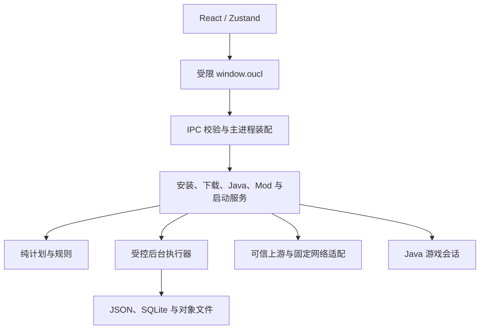

# OUCL 0.3.0 技术方案（按实际交付重建）

日期：2026-11-15（Asia/Shanghai）。性质：已交付架构说明及后续候选增量，不是新业务、契约、依赖或存储格式的批准记录。

## 1. 基线与证据优先级

本方案描述正式 `OUCL-0.3.0.exe` 实际交付边界，替代“仍处于空骨架/只有纯解析”的过时理解；不改写历史提案或验收结果。执行授权仍以 [TASK_PLAN](../OUCL-Codex/docs/TASK_PLAN.md) 和 [DECISIONS](../OUCL-Codex/docs/DECISIONS.md) 最新真实记录为准。

| 对象 | 固定基线 |
| --- | --- |
| 本次读取的 main | `05309ed7`，包含最终交付与目录整理记录 |
| 已验产品源码 | `0c2a889ccea544d3294136a80c74ac8a5e6f348f`；后续交付记录说明沿用已验产品 |
| 正式 EXE | `OUCL-0.3.0.exe`，410112 字节 |
| EXE SHA-256 | `6d4f7f25d29a06b4d3730fd79ad64a160dbcdb28f747e20eda1ce05f98cc690e` |
| 应用载荷 appHash | `272cc737f3bade0a6b197f7907b21b2dce2acce854f1d4cc8347155fb3f62291` |
| Electron | 45.0.0，运行时固定摘要见交付 package.json |
| 内嵌载荷 | 九个文件条目，其中七个 dist 产品文件 |
| 状态 | 已完成选定增量的有限技术接纳和本地交付；未签名，未 push/公开发布 |

依据：[最终交付](delivery/20261115/DELIVERY.md)、[包审计](delivery/20261115/package-audit.json)、[v35 有限验收](acceptance/20261115-v35/REPORT.md)、[v36 网络诊断](acceptance/20261115-v36/REPORT.md)。

源码、构建产物、正式 EXE 和实机结果必须分别关联。当前 `mod_loaders` 活跃树的未提交改动不自动属于正式包；后续不能整体暂存、清理或覆盖它们来制造一致状态。

## 2. 产品目标与功能边界

OUCL 是面向高校社团的 Minecraft Java 桌面客户端。当前可交付核心是可信下载、Java 准备、离线档案、隔离实例、加载器与 Mod 管理，以及真实游戏启动。社团后台与联机仍为后续独立范围。

| 能力 | 当前交付层级 | 必须保留的边界 |
| --- | --- | --- |
| 原版安装与启动 | 已接 UI/服务/EXE，有代表游戏证据 | 不等于全版本、所有世界与设备矩阵通过 |
| 四加载器 | Fabric/Quilt/Forge/NeoForge 已有服务与界面 | 各加载器历史证据分别保留，不合并成全组合通过 |
| Java | 检测/登记、兼容选择、缺失时按需准备、启动前复测 | 主要支持 8/17/21；完整公开有效 Java 管理面板未交付 |
| 离线档案 | 创建、选择、持久身份与启动接入 | 不是微软认证，不能绕过服务端正版验证 |
| Modrinth 资源库 | 搜索、版本选择、校验下载、本地资源记录 | 资源下载与写入实例是不同操作 |
| Mod 安装 | JAR 声明/平台检查、依赖计划、确认、任务、事务与结果 | 已知声明满足不等于实际游戏兼容；已有 Mod 不因可选依赖自动升级 |
| Mod 维护 | 只读启用/禁用影响预览 | 不执行真实文件启停、卸载或批量维护 |
| 任务中心 | 分页、状态、订阅/查询、重连与只读目标 | 调用超时不等于任务取消；取消能力按任务开放 |
| 外观 | 配色、侧栏、密度、布局、卡片顺序和受控图标 | 不是任意脚本主题或插件系统 |
| 论坛 | 本地草稿及前端数据源边界 | 没有线上发帖、成员后台或邮件服务 |
| 整合包 | 固定 1355 字节样本只读预览 | 不是通用导入、安装或分发产品 |
| 分发源 | 版本化签名契约、纯差异预览、内存测试适配器 | 无产品远程源、公钥配置、后台或自动更新 |

## 3. 技术栈与模块职责

维持 TypeScript strict + Electron + React + pnpm；Zustand 管理界面投影，Vite 构建 renderer，esbuild 构建 main/preload/worker。测试以 Node 内置 test 为主。`smol-toml` 仅用于标准 Mod TOML 声明解析。固定版本见 [package.json](../package.json)，历史依赖评估见 [DEPENDENCIES](DEPENDENCIES.md)。

| 层 | 位置 | 职责与限制 |
| --- | --- | --- |
| 纯规则 | `src/core` | 版本、路径、安装/启动计划、依赖规则、任务状态转换；无真实 IO、UI 和 Electron |
| 业务服务 | `src/services` | 网络、对象仓库、安装、Java、Mod、文件与进程编排；平台行为由明确适配器承担 |
| 桌面装配 | `src/main` | 生命周期、单实例、窗口、安全策略、网络适配及服务初始化/关闭 |
| 通信 | `src/ipc` | 固定 bridge、请求/响应校验、身份与对象归属、订阅生命周期 |
| 共享定义 | `src/shared` | 版本化契约、错误与 messages.ts 文案 |
| 界面 | `src/ui` | React 页面、Zustand、任务查询和观察；只接收受控公开投影 |
| 后台执行 | `src/services/workers` | 存储、哈希、JAR 等有界任务；固定入口与白名单命令 |
| 外层引导 | `bootstrap` | Windows 环境准备、校验与拉起 Electron；不承接游戏业务 |

这些是职责层，不是每层单独一个进程。重计算和同步 SQLite 工作主要由后台执行器承担；所有权守卫还涉及主进程维护的独占数据库锁，不应把“数据库操作全在 worker”当成无例外事实。

## 4. 桌面安全与通信

窗口保留 contextIsolation、sandbox，禁用 nodeIntegration/webview，限制导航和新窗口。当前本地 Vite 产物采用相对资源路径并由 loadFile 加载；外部网页视图不是已交付能力。

bridge 不开放任意 invoke/channel、SQL、路径或 shell。主进程核对可信窗口、精确文档和主 frame；请求带版本、UUID 和受控 payload，preload 复核响应。私有路径、原始元数据、凭证和堆栈不作为公开结果返回。

握手根据实际服务初始化状态广告能力。契约中存在某个字符串，不表示服务必定已准备完成，也不表示产品已运行验收。相关能力包括实例/任务、加载器、Mod、资源、外观、只读任务目标、维护影响预览和固定样本预览。

幂等请求保留业务身份与内容摘要；同身份不同输入拒绝。调用超时表示结果未知，应按原身份查询或恢复受理；退订只结束观察，不取消任务。根或实例切换后用代次/身份检查拒绝迟到数据覆盖新目标。

## 5. 存储、共享与隔离

| 数据 | 介质 | 不变量 |
| --- | --- | --- |
| 设置、档案、实例等 | schemaVersion/revision/data JSON | 原子提交、CAS 修订、固定领域 schema、未知格式停写 |
| 任务与幂等 | SQLite | 接纳和请求记录事务关联，不能当缓存删除 |
| 操作日志 | SQLite/固定领域记录 | 记录提交和恢复依据；不能用可重建索引代替 |
| 下载前缀 | 传输 SQLite | 按已同步并确认的字节恢复，不凭 .part 长度猜测 |
| 大文件 | 固定共享对象仓库 | SHA-256 内容寻址，独立来源证明，上游摘要是信任依据 |
| 对象搜索提示 | 独立索引 | 可依证明和复验重建，但未知库不随意删除 |

文件本体相同不自动建立可信来源。复用对象仍需核对来源证明及实际内容。不可变文件通过受控软链接或复制投影；复制回退如实登记。玩家存档、配置和其他可写内容不得因链接破坏共享本体。

实例 UUID、目录身份、上游 Minecraft 版本及隐藏继承依赖分别建模。隔离时使用实例 gameDir；非隔离实例共享根玩家目录，按真实 gameDir 排他。隔离设置改变不自动迁移旧存档。正式恢复流程不按 PID/时间盲目删除所有者标记；现有 guard 仅在其可证明条件内协调释放和恢复。

参考：[对象仓库](contracts/OBJECT_STORE.md)、[实例安装](contracts/INSTANCE_INSTALLATION.md)、[文件投影](contracts/FILE_VIEWS.md)。早期契约末尾的“未接入”应结合后续公共装配和验收理解，不作为当前总状态。

## 6. 下载、安装与任务执行

安装顺序：官方目录/元数据验证 → 纯安装计划 → 持久任务接纳 → 可信传输/对象复用 → 文件投影 → 实例 ready 提交 → 任务完成。下载结束不代表安装结束；ready 仍不能替代启动前复验。

下载协调区分逻辑消费者和物理传输，允许相同可信内容共享下载；取消一名消费者不能破坏其他消费者。文件并发和大文件分段有界，镜像只加速，上游可信摘要仍决定完整性。跨来源的断点验证信息不能混用。

桌面网络显式注入 Electron net.request 适配，保持 HTTPS、证书和跳转边界；不能把上传 Writable 的 close 当成整个响应事务结束。v36 仅证明受控本机活动性与 AbortSignal 到原生 abort 链，不证明特定公网预览取消。

任务状态包括 queued、running、verifying、committing、cancelling、completed、failed、cancelled、needsRecovery 等。存在 pause 状态不表示所有 UI 任务支持暂停。进入不可回退提交点后明确拒绝取消；失败清理结果不确定时进入 needsRecovery，不虚报成功或安全撤销。

## 7. Java、身份与启动会话

Java 优先复测已登记兼容项，再有限发现，缺失时按 Mojang 运行时清单下载并校验；不扫描全盘、不修改系统 PATH，不执行不完整暂存树。选择偏好与环境检查使用一致规则，不能以未复测的旧补丁版本推翻明确选择。

离线档案的显示昵称、游戏名、accountId 和离线 UUID 分离；游戏身份变化不直接覆盖旧身份。当前没有产品微软 PKCE、Yggdrasil 或凭证管理闭环，不因参考启动器已有认证而声称本项目已支持。

启动前复核实例修订、Java、内存、制品、原生库及 Mod 环境，生成参数数组，以 shell:false 创建 Java 会话。会话标记绑定真实 gameDir，未知占用不抢占。启动任务 completed 表示进程已建立，不是主菜单或游戏世界验收。

进程实际 close 后记录退出和释放本人占用。Windows 温和停止不支持时明确反馈，不自动强杀；force 须显式确认。游戏运行期间关闭启动器窗口保活并隐藏，等游戏结束与服务收尾后真正退出；历史 running 会话不靠 PID 猜测接管。

## 8. 加载器与 Mod 安装

四加载器复用实例与下载基础。Fabric/Quilt 依目录和依赖建立环境；Forge/NeoForge 处理官方安装器、处理器与产物证明。代表版本环境与历史实机结论分别记录，不扩成全部版本支持声明。

Mod 流程：真实 JAR 扫描 → 声明与平台来源双重检查 → 有界依赖计划 → 保存计划 → 玩家确认 → 重新复验/下载 → 私有暂存 → 受管发布/复扫 → 实例修订提交 → 受控结果与任务。

计划绑定 root、instance、修订、库存指纹和精确文件身份；旧计划不能用于变化后的实例。可写 Mod 使用私有副本，不直接链接共享不可变对象。提交回退只处理可证明属于本操作且未被外部修改的内容，未知文件与玩家修改保留。确认、任务取消与恢复共用已有基础，不为每次 UI 修改新增执行入口。

维护影响预览独立于真实安装与启停；预览有期限、取消和同请求一致性约束，结果明确标记不确定性。当前不实现真实启停、卸载。

参考：[公共安装](contracts/MOD_PUBLIC_INSTALL.md)、[Mod 事务](contracts/MOD_TRANSACTION.md)。

## 9. 当前界面与扩展边界

首页、下载、论坛和设置共享档案/实例/任务投影。任务中心采用有界查询/观察和单调修订，不以断线判断失败。已有外观和本地论坛草稿沿 desktop.v1 保存，不需要另起主题存储或后台。

固定包入口只校验约定样本并返回只读预览；未知环境不提供安装许可。DistributionSource 仅定义版本化 Ed25519 信封、受控区域、add/replace/remove/keep 和纯 diff；真实源、信任公钥/轮换、网络适配、安装提交尚未启用。replace/remove 需要受管身份及旧摘要同时匹配，清单遗漏不转换为删除。

## 10. 正式 EXE 与数据位置

外层 C# 引导在 Windows x64 准备环境和内嵌应用。Electron ZIP 的官方位置与摘要固定进 EXE；应用内嵌逐文件摘要。首次缺环境时需要网络，后续按校验缓存复用；无自动更新与发布签名承诺。

缓存位于 EXE 同级 OUCL.runtime，应用 profile 默认随当前便携引导策略确定；显式测试 profile 与历史配置不能混为一谈。首次无既有游戏根记录时建立同级 OUCL.games；用户已选根优先，不自动迁移或删除旧数据。EXE 小不代表完整运行时或游戏数据很小。

源码中的运行数据路径为运行时派生，不能硬编码当前整理后的本机目录。源码、EXE 和报告中旧绝对路径是历史位置，定位应结合当前目录入口和摘要。

## 11. 验收结论与本轮复核

历史 v31 完整回归为 691 项：687 PASS、0 FAIL、4 SKIP，类型/lint/build 通过。v35 在同 v32 载荷上记录原版、Fabric/FerriteCore、Quilt及重开后 Quilt 共四次菜单/自然 exit0，最终 launcher exit0 和租约释放；正式名称 EXE 与 v32 的 appHash 相同，不能将其重命名打包称作新做了一遍 GUI 游戏测试。

v36 的网络诊断没有发现生产代码缺陷，但历史具体请求关联 UNKNOWN、公网 pending 取消 NOT_EXERCISED 保留。最终 EXE 强杀恢复、不可达 frame 等用户已取消继续补证的格，不改成 PASS；后续仅在明确新范围和条件下处理。

本轮 2026-11-15 复核：正式 EXE 的九文件摘要/长度全部匹配交付清单；冻结 main 副本类型、lint、构建及 34 项引导器检查通过。完整单测为 691 项、662 PASS/25 FAIL/4 SKIP，涉及回环网络、链接权限和 Mod 扫描/事务断言，根因未全部定位，不能宣称重新验收全过。重建七产物中五项字节一致，两项仅依赖路径行注释不同，不称逐字节可复现。详情与原始日志见 [本轮记录](delivery/20261115/RECHECK.md)。本轮未新运行 GUI、Java 游戏或强制中断测试。

## 12. 参考设计转化为后续候选

2026-11-15后继执行状态：用户随后明确要求持续实施；N1—N4见提交9a996463，N5隔离基础设施与N6签名/所有权只读首片见 [持续执行记录](execution/20261115/CONTINUATION.md)。用户确认站点未定、来源与公钥先空出，真实接入和N6执行/恢复仍未交付。下表保留候选形成时的历史边界，不将旧PENDING批量当作全部已实现。

以下全部为 PENDING 候选，不写入“已交付功能”，也不构成开发授权。

| 顺序 | 候选增量 | 复用现有基础 | 明确新增边界与验收 |
| --- | --- | --- | --- |
| N1 | 实例只读概览与统一任务反馈 | 实例身份、目录入口、任务/会话与受控错误 | 先盘点已有 DTO；如需公开 Java 事实或新 IPC，先审批；切实例无迟到覆盖、断线不伪终态 |
| N2 | 首次启动引导 | 根目录、离线档案、Java 与设置 | 可跳过/重试，不覆盖既有选择；不把新引导等同新增账号认证 |
| N3 | 外观体验完善 | desktop.v1 与 React 组件 | 预览/保存/恢复和窄窗口；Webstudio 仅可作为视觉参考，不默认替换前端 |
| N4 | 工具箱固定入口及一个轻工具 | UI、文案、纯规则 | 从渐变文字/旗帜等选一个；固定注册表，无任意 JS 插件；持久化/文件导出另审批 |
| N5 | 隔离在线工具 | Electron 容器 | 独立 WebContentsView/session，不给 window.oucl；导航/权限/下载生命周期专项审批与验收 |
| N6 | 社团包所有权与分发产品 | 签名契约、diff、Mod 事务 | 区分包管理/用户添加/本地发现/用户覆盖；批准 schema、可信源、公钥轮换及真实执行流程 |
| 后续 | 重型编辑器、Bridge、只读 MCP、联机 | 后台服务与 worker 能力 | 分别技术验证、依赖/许可/协议与权限审批，不并入一次 UI 改版 |

借鉴 KAMUCL 的实例入口、确认与布局体验，借鉴 Axolotl 的内容归属、安装预览和任务表达。保留 OUCL 的纯 core、受限 bridge、来源验证和事务边界；不照搬通用 invoke、同页高权限 JS 插件、未知文件删除或 Rust/Tauri/Vue 整体迁移。

## 13. 后续工作的操作要求

1. 每次首先读取有效计划和批准；本方案不解除阶段门禁。
2. 从明确的已验基线建立增量；活跃 WIP 按文件/变更核对，不能整体覆盖或自动接纳。
3. 一个增量明确修改文件、接口/数据变化、风险和可复现验证。
4. 保留历史 FAIL、UNKNOWN、SKIP 和取消补证记录，避免反复无界验收。
5. 文档链接、实际源文件、产物摘要、命令与测试结果分别验证。未经明确授权不 push、发布或引入额外依赖。
